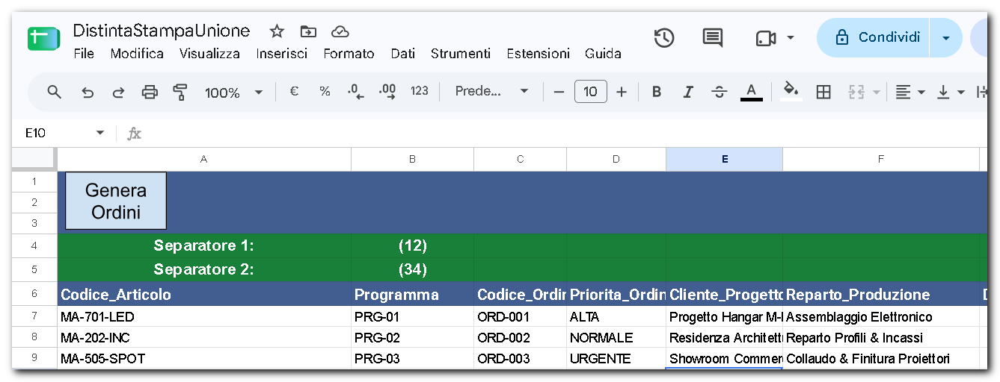
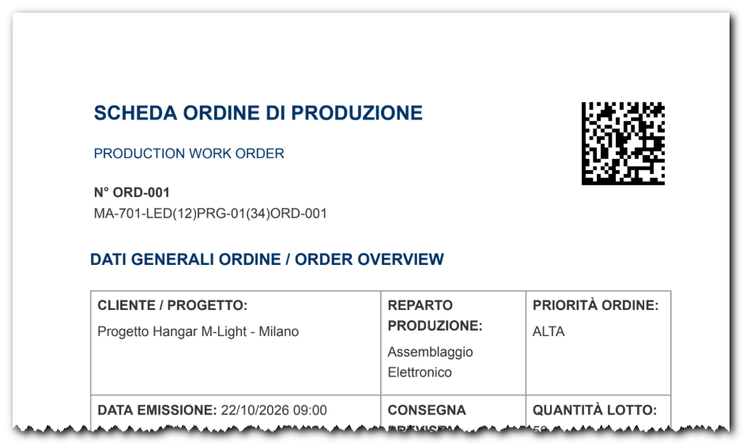

# 📄 Distinta Stampa Unione

Una soluzione open source basata su **Google Apps Script**  per automatizzare la generazione di ordini di produzione in formato PDF a partire da un foglio **Google Sheets**, con l'integrazione di modelli **Google Docs** e codici 2D **DataMatrix**.

---

## 🖼️ Anteprima e Struttura del Progetto

Ecco come organizzare i file su Google Drive e come appaiono la gestione dati e il PDF finale:

### 1. Struttura Cartella su Google Drive


### 2. Google Sheets (Gestione Dati)


### 3. Risultato Finale (PDF con DataMatrix)


---

## 🚀 Caratteristiche Principali

* 📊 **Integrazione Google Workspace**: Generazione automatica di documenti PDF a partire da dati inseriti in Google Sheets.
* 🏷️ **Codici DataMatrix 2D**: Generazione e inserimento dinamico dei codici DataMatrix nel documento tramite la libreria [BWIP-JS](https://github.com/metafloor/bwip-js).
* 📑 **Gestione Modelli**: Utilizzo di file Google Docs come template grafici e strutturali.
* 📂 **Workflow e Destinazione Automatici**: Creazione automatica della sottocartella `reports` nella directory del progetto per il salvataggio ordinato di tutti i documenti PDF generati.

---

## 👁️ Esempio di Risultato (PDF)

Vuoi scaricare e visualizzare direttamente il documento finale? 
* 📥 **[Scarica l'Esempio di PDF Generato](./esempio-ordine.pdf)**

---

## 📂 Modelli e File di Esempio

Per testare e utilizzare il progetto, abbiamo messo a disposizione i file di esempio (Foglio di calcolo con Apps Script già incorporato e Modello Google Docs) protetti in sola lettura. 

👉 **[Accedi alla Cartella dei Modelli di Esempio su Google Drive](https://drive.google.com/drive/folders/1TjsqBlEYKjHKwB-pydBG4JT9kQFHzxI4?usp=sharing)**

> **Come utilizzarli:**
> 1. Apri ciascun file presente nella cartella condivisa.
> 2. Seleziona dal menu **File > Crea una copia** per salvarne una versione modificabile all'interno della tua cartella Google Drive personale.

---

## 🛠️ Guida all'Uso e Avvio Rapido

Lo script Google Apps Script è già **incorporato nativamente** all'interno del Foglio Google di esempio, quindi non occorre copiare o incollare alcun codice.

1. **Copia i Modelli**: Salva una copia del Foglio Google e del Modello Google Doc nella tua cartella su Google Drive (es. `Miodrive/StampaUnione`).
2. **Usa il Pulsante "Crea Ordini"**: All'interno del Foglio Google troverai un pulsante grafico integrato denominato **`Crea Ordini`**.
3. **Primo Avvio (Autorizzazione)**: 
   * Alla prima pressione del pulsante **`Crea Ordini`**, Google richiederà di concedere i permessi di esecuzione per interagire con i Fogli, Documenti e Drive.
   * Clicca su **"Autorizza accesso"**, seleziona il tuo account Google, fai clic su **"Avanzate"** e infine su **"Vai a DistintaStampaUnione (non sicuro)"**. Accetta i permessi richiesti.
4. **Generazione dei PDF**: Una volta autorizzato, ogni clic su **`Crea Ordini`** avvierà la stampa unione. Lo script creerà automaticamente la sottocartella **`reports`** (se non già presente) e vi salverà i file PDF generati.

---

## 📋 Prerequisiti della Struttura Fogli
Per fare in modo che lo script legga correttamente i dati, assicurati che il Google Foglio di esempio mantenga la struttura delle intestazioni di colonna previste (es. riferimenti articolo, quantità, codici per il DataMatrix).

---

## 📌 Struttura della Stringa DataMatrix e Separatori `(12)` e `(34)`

Durante il processo di stampa unione, la stringa inviata per la generazione del codice 2D DataMatrix viene formattata combinando i valori delle colonne secondo la seguente sintassi:

```text
[Codice_Articolo](12)[Programma](34)[Codice_Ordine]
```

### Significato dei Separatori:
* **`(12)` (Separatore Articolo / Programma)**: Agisce da delimitatore di campo per separare nettamente il codice articolo dal programma di produzione durante la lettura.
* **`(34)` (Separatore Programma / Ordine)**: Identificatore e delimitatore di campo che separa il codice programma dall'identificativo unico dell'ordine di produzione.

L'adozione di questi identificatori all'interno della stringa DataMatrix permette ai lettori di codici 2D e ai sistemi software aziendali (MES/ERP) di parsare istantaneamente e con precisione i singoli campi durante la scansione industriale.

---

## ❓ FAQ & Troubleshooting

* **Come avvio la generazione se non trovo il menu in alto?**  
  Basta fare clic sul pulsante grafico **`Crea Ordini`** presente all'interno del Foglio Google.
* **Dove vengono salvati i file PDF una volta generati?**  
  I PDF vengono depositati direttamente all'interno della sottocartella **`reports`**. Se non è presente, lo script provvederà a crearla automaticamente nella medesima cartella dove risiede il tuo Google Sheet.
* **Lo script dà un errore di autorizzazione durante l'esecuzione?** 
  Assicurati di aver completato tutti i passaggi di sblocco ("Avanzate" > "Vai a...").

---

## 📜 Crediti e Dipendenze

* Per la generazione dei codici DataMatrix viene utilizzata l'ottima libreria open source **[BWIP-JS](https://github.com/metafloor/bwip-js)** (Bar Code Writer in Pure JavaScript).

---

## 📄 Licenza

Questo progetto è rilasciato sotto licenza [MIT](LICENSE) - libero per uso personale e commerciale.
